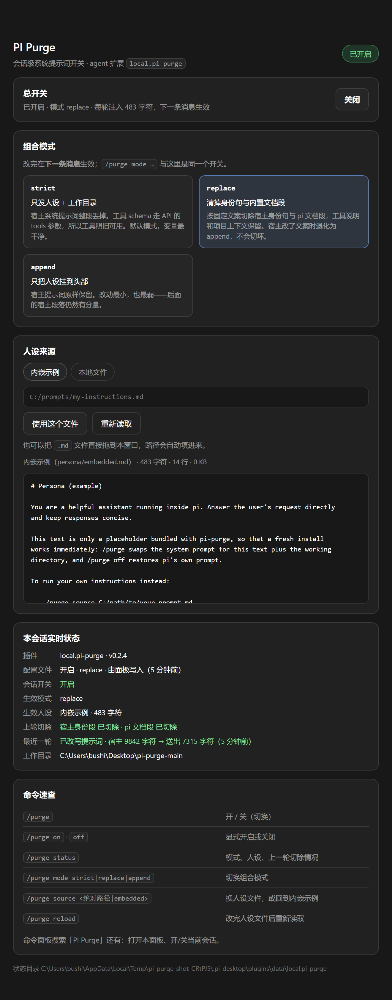
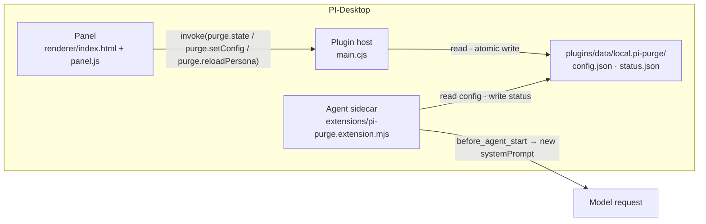

# PI Purge for PI-Desktop

[English](README.md) | [中文](README.zh-CN.md) | [日本語](README.ja.md) · [CLI reference](docs/cli.md)

[](https://github.com/UserCrazyLove/pi-purge-desktop/actions/workflows/ci.yml)
[](https://github.com/UserCrazyLove/pi-purge-desktop/releases)
[](LICENSE)
[](https://github.com/earendil-works)
[](package.json)

A PI-Desktop plugin that puts the system prompt of a pi session behind a switch, and behind a panel you can actually see.

The agent normally runs with pi's harness prompt: an assistant identity line, a bundled documentation section, a tool list, guidelines, and your project context. This plugin lets you replace the framing of a session with your own persona text — and lets you choose **how much** of the harness survives. Same idea as the `/purge` CLI extension it ships, plus a visual control panel, a persisted configuration, and live per-turn telemetry, so an experiment is a few clicks instead of a sequence of commands.

Turned off, nothing changes: no prompt rewrite, no disk reads, pi behaves exactly as if the plugin were not installed.




*Sample state, captured from an isolated test home: switch on, `replace` mode, bundled persona, and the last turn's real cut — the host prompt went from 9 842 characters to 7 315 sent.*
> **Adapted to PI-Desktop v0.21.0** — the release this plugin is developed and tested against. The version floor is 0.15.9, which introduced the plugin data-directory API the state lives in.

```text
pi-purge-desktop/
├── pi-desktop-plugin/          the deliverable — manifest, host entry, panel, agent extension
├── extensions/pi-purge.ts      the CLI extension (same mechanism, command only)
├── docs/                       CLI reference, panel screenshot
└── test/                       the two CLI suites (the two plugin suites live in pi-desktop-plugin/test/)
```

## Features

| | |
| --- | --- |
| **Control panel** | A real window: master switch, mode cards, persona source, live status. No command syntax to memorise. |
| **Three composition modes** | `strict` (persona + working directory only), `replace` (persona + harness prompt minus identity line and docs), `append` (persona prepended to the stock prompt). |
| **Persona from a file or the bundle** | Pick a shipped example, type an absolute path, or drag a `.md` onto the panel. Relative paths are stored as absolute ones. |
| **Persisted config** | The panel writes `enabled / mode / source` to the host's per-plugin data directory, so a new session starts the way you left it. Delete the file to return to CLI semantics. |
| **Live per-turn telemetry** | After each turn the panel shows whether the identity and documentation sections were cut, the host prompt's character count and the characters actually sent, and the working directory of the session that ran. |
| **Command parity** | `/purge`, `/purge on\|off\|status`, `/purge mode …`, `/purge source …`, `/purge reload`, with argument completions. Both surfaces write the same config; last writer wins. |
| **Honest failure** | An unreadable persona does not silently switch the feature off: the switch stays where you left it, the turn is simply not rewritten, and the reason travels back to the panel. A corrupt `config.json` is reported and never overwritten. |
| **Offline by construction** | No `net` permission, no network code, no telemetry, no auto-update. Two local JSON files are the whole protocol. |

## Install

**Option A — packaged plugin.** Download `local.pi-purge-<version>.piplug` from [Releases](https://github.com/UserCrazyLove/pi-purge-desktop/releases), then install it from PI-Desktop's plugin page. The installer will ask you to approve `agent.extension`; that permission is what lets the theme rewrite the outbound system prompt, and it is the reason this plugin is flagged high-risk — see [Permissions](#permissions-and-safety).

**Option B — development load.** Copy `pi-desktop-plugin/` into PI-Desktop's plugin directory, or point the host at it as a local plugin. The host watches the directory recursively, which is why the plugin never writes its own runtime state there (see [Where state lives](#where-state-lives)).

Either way, then:

- open the panel from the command palette (`PI Purge: 打开控制面板`) or the plugin list, or
- flip `PI Purge: 开/关当前会话` if you only want the toggle.

The extension itself is loaded automatically through `contributes.agentExtensions` — no `pi install` step, no npm dependency, no `node_modules`.

Adapted to, and tested on, **PI-Desktop v0.21.0** — see the note above. Tests need Node `>= 22.19.0`.

## Using the panel

1. **Switch** — off / on for every new session. Default off.
2. **Mode** — `strict` (default), `replace`, or `append`. Each card states exactly what is cut.
3. **Persona** — *bundled example*, or *local file* (typed path or drop zone). The panel previews the first 4000 characters, warns about a BOM or invalid UTF-8, and flags oversized files.
4. **Status** — for the last turn: applied / not applied, which sections were cut, `host → sent` character counts, and the session's working directory.
5. **Commands** — the `/purge` cheat sheet, so the two surfaces do not drift apart in your head.

Changes apply to the next message; the panel reports that instead of pretending otherwise.

## Modes

| Mode | System prompt sent to the model | Use it when |
| --- | --- | --- |
| `append` | Your prompt prepended to pi's prompt, unchanged. | You want a control run: baseline behaviour plus your instructions on top. |
| `replace` | Your prompt, then pi's prompt with its built-in assistant identity line and bundled documentation section removed. Tool list, guidelines and project context stay. | You want to measure the effect of the harness framing without losing tool context. |
| `strict` | Your prompt plus `Current working directory: …` only. | You want to isolate your instructions as a single variable. This is the default. |

`replace` locates both sections by exact wording. If a pi update rewords them, it leaves the prompt intact rather than cutting the wrong text, and `/purge status` reports `身份段 未匹配` (identity line not found) — behaviour degrades to `append`. `strict` does no matching at all, so it behaves the same across pi versions.

Tool schemas travel in the API `tools` parameter rather than the system prompt, so tools keep working in every mode, including `strict`.

## Commands

| Command | Effect |
| --- | --- |
| `/purge` | Toggle on/off for this session |
| `/purge on` / `off` | Enable or disable the rewrite |
| `/purge status` | Mode, prompt source, loaded size, and what the previous turn actually changed |
| `/purge mode append\|replace\|strict` | Switch composition mode |
| `/purge source <path\|embedded>` | Change the prompt file, or go back to the bundled example; a failed switch rolls back |
| `/purge reload` | Re-read an external prompt file after editing it |

The CLI-only details — session scope, `PI_PURGE_SOURCE`, upgrading from 0.1.x, experiment notes — live in the [CLI reference](docs/cli.md).

## Where state lives

Two files, and only two, in the host's per-plugin data directory:

```text
%USERPROFILE%\.pi-desktop\plugins\data\local.pi-purge\      (Windows)
~/.pi-desktop/plugins/data/local.pi-purge/                  (macOS / Linux)
├── config.json     written by the panel and by /purge — last writer wins
└── status.json     written by the agent extension after each turn — read-only for the panel
```

Resolution order, identical in both processes: a `state-location.json` pointer written by the host when its data directory is somewhere else → the per-plugin data directory → `<plugin dir>/state/` → `<plugins dir>/data/<id>`. Both sides probe the candidate with a real write, so they can never disagree about where the state is.

**Why not inside the plugin?** PI-Desktop watches a development plugin's directory recursively. A state file there turns into write → reload → write: a reload storm. Runtime state therefore stays out of `pi-desktop-plugin/`, the single exception being the `state-location.json` pointer the host writes when its data directory is not where the default layout says — and two tests assert that nothing else ever lands there.

## Architecture



- `main.cjs` is CommonJS on purpose: the repository root is `"type": "module"`, so a `.js` entry point would be loaded as ESM and crash. PI-Desktop's own pi-extension importer writes `main.cjs` for the same reason.
- The panel never touches the filesystem: it reads and writes through the host's panel channels (`purge.state`, `purge.setConfig`, `purge.reloadPersona`), plus `app.getAppearance` for the light/dark preference and `ui.showToast` for feedback.
- The agent extension re-reads `config.json` on `session_start` and before every turn, so a panel edit applies to the next message of an already-running session.

## Permissions and safety

| Permission | Risk | What it actually does |
| --- | --- | --- |
| `agent.extension` | high | Loads the extension inside the Agent sidecar. With Node access, it rewrites the system prompt this session sends to the model. |
| `ui.panel` | low | Opens the control-panel window. |

What it does **not** do: no network permission, no network code, no telemetry, no auto-update, no writes outside its own data directory, no reads outside the persona file you name yourself. Prompt content never leaves the machine except as the request you were already sending.

`strict` also drops `AGENTS.md` / project context, the skills list, and prompt sections injected by other extensions — that is what makes it a clean single-variable setup, and also what makes its results incomparable to a normal session. `config.json` is one global file, not one per session; the panel shows the state written by the most recently run session.

Read [LEGAL.md](LEGAL.md) before installing: the project ships hard use restrictions, and they are part of the licence as far as the author is concerned.

## Development

```bash
npm test        # 4 suites: 2 CLI, 1 extension, 1 panel/host — no dependencies, no network
```

| Suite | File | Cases |
| --- | --- | --- |
| CLI extension | `test/pi-purge.test.mjs` | prompt composition and session scope |
| CLI env source | `test/pi-purge-env-source.test.mjs` | `PI_PURGE_SOURCE` handling |
| Plugin extension | `pi-desktop-plugin/test/pi-purge.extension.test.mjs` | 15 |
| Plugin host + panel | `pi-desktop-plugin/test/panel-host.test.mjs` | 12 |

Tests isolate `USERPROFILE` / `HOME` into a temporary root and install a copy of the plugin at `<root>/installed/local.pi-purge`, so the real resolution rules are exercised without touching your real plugin data. CI runs the same command on Ubuntu and Windows.

Hard constraints for changes — see [CONTRIBUTING.md](CONTRIBUTING.md):

- the host entry stays `main.cjs`;
- nothing but the `state-location.json` pointer is written into `pi-desktop-plugin/` at runtime;
- panel and extension keep the same state-directory candidate list and the same write probe;
- no network access, no new permissions.

## Credits

- **Mechanism** — ported from [YuJunZhiXue/dsh-purge](https://github.com/YuJunZhiXue/dsh-purge): the idea of *removing* the harness identity line rather than drowning it out, the three composition modes, and the bundled prompt all come from that project. Credited and linked as its author requires.
- **CLI extension** — a fork of [ZiChuanLan/pi-purge](https://github.com/ZiChuanLan/pi-purge) (MIT, © 2026 ZiChuanLan); `extensions/pi-purge.ts` and the two CLI suites originate there. This repository adds the PI-Desktop host, the control panel, and the persisted state.
- Thanks to the [LINUX DO](https://linux.do) community.

## License

[MIT](LICENSE) — non-profit, study and research use only, subject to the restrictions in [LEGAL.md](LEGAL.md).