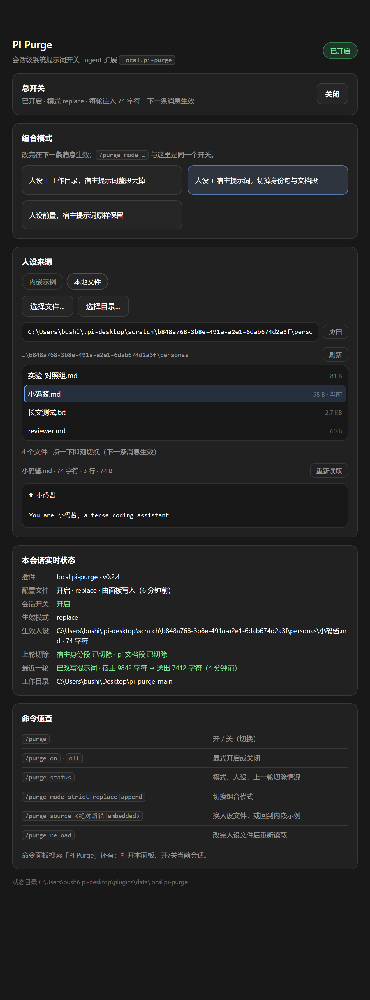
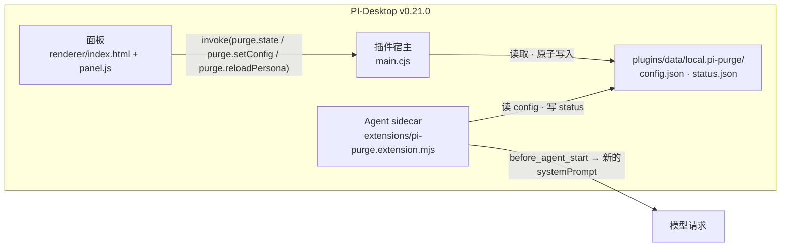

# PI Purge（PI-Desktop 版）

[English](README.md) | [中文](README.zh-CN.md) · [CLI 扩展参考](docs/cli.zh-CN.md) · [日本語](README.ja.md)

[](https://github.com/UserCrazyLove/pi-purge-desktop/actions/workflows/ci.yml)
[](https://github.com/UserCrazyLove/pi-purge-desktop/releases)
[](LICENSE)
[](https://github.com/earendil-works)
[](package.json)

一个 PI-Desktop 插件：把 pi 会话的系统提示词做成一个开关，并且做成一个你看得见的控制面板。

Agent 平时是带着 pi 的宿主提示词跑的：身份句、内置文档段、工具清单、行为准则、你的项目上下文。这个插件让你用自己的人设文本替换会话的框定方式，并且可以选**保留多少宿主提示词**——和它自带的 `/purge` CLI 扩展同一套机制，另外加了可视化面板、持久化配置、逐轮实测数据，让一次实验从敲一串命令变成点几下。

关掉时什么都不变：不改提示词、不读磁盘，pi 的行为和没装这个插件完全一样。




*示例状态，取自隔离的测试主目录：开关打开、`replace` 模式、内嵌人设，以及上一轮的实际切除结果——宿主提示词 9 842 字符 → 实际送出 7 315 字符。*
> **适配版本：PI-Desktop v0.21.0**——本插件的开发与实测环境。版本下限 0.15.9，即状态所用的插件数据目录 API 的引入版本。

```text
pi-purge-desktop/
├── pi-desktop-plugin/          交付物：manifest、宿主入口、面板、agent 扩展
├── extensions/pi-purge.ts      CLI 扩展（同一套机制，只有命令）
├── docs/                       CLI 参考、面板截图
└── test/                       两个 CLI 测试套件（另外两个在 pi-desktop-plugin/test/）
```

## 特性

| | |
| --- | --- |
| **控制面板** | 真正的窗口：总开关、模式卡片、人设来源、实时状态。不用记命令语法。 |
| **三档组合模式** | `strict`（只发人设 + 工作目录）、`replace`（人设 + 宿主提示词，切掉身份句与内置文档段）、`append`（人设前置到原提示词）。 |
| **人设来自文件、目录或内置** | 选内置示例；点**选择文件…**在系统对话框里挑单个文件（立即生效）；点**选择目录…**列出一个文件夹里的 `.md` / `.markdown` / `.txt`，**点一下即切换**；也可以把文件或整个文件夹拖进面板，或直接填绝对路径。相对路径会被存成绝对路径。 |
| **配置跨会话保留** | 面板把 `enabled / mode / source` 写进宿主的插件数据目录，新会话按你上次的样子启动；删掉该文件即回到 CLI 的「每会话关闭」语义。 |
| **逐轮实测数据** | 每轮之后面板显示身份段/文档段是否被切掉、宿主提示词字符数 → 实际送出字符数、以及跑这一轮的工作目录。 |
| **命令与面板等价** | `/purge`、`/purge on\|off\|status`、`/purge mode …`、`/purge source …`、`/purge reload`，带参数补全。两个入口写同一份配置，后写者生效。 |
| **失败不装死** | 人设读不出来时不会悄悄把功能关掉：开关保持你留下的状态，这一轮只是不改写提示词，原因通过 `status.json` 回到面板。`config.json` 损坏时报错且绝不覆盖。 |
| **天生不联网** | 没有 `net` 权限、没有网络代码、没有遥测、没有自动更新。协议就是两个本地 JSON 文件。 |

## 安装

**方式 A —— 安装打包好的插件。** 从 [Releases](https://github.com/UserCrazyLove/pi-purge-desktop/releases) 下载 `local.pi-purge-<版本>.piplug`，然后在 PI-Desktop 的插件页安装。安装器会要求你批准 `agent.extension`：这个权限正是「改写外发系统提示词」的能力来源，也是本插件被标为高风险的原因，详见[权限与安全](#权限与安全)。

**方式 B —— 开发态加载。** 把 `pi-desktop-plugin/` 放进 PI-Desktop 的插件目录，或按本地插件指向它。宿主会**递归监听**这个目录，所以插件从不把自己的运行期状态写进去（见[状态存在哪里](#状态存在哪里)）。

两种方式装完之后：

- 从命令面板（`PI Purge: 打开控制面板`）或插件列表打开面板，或者
- 只想要开关时，直接用 `PI Purge: 开/关当前会话`。

扩展本身通过 `contributes.agentExtensions` 自动加载——不需要 `pi install`，不依赖 npm 包，不需要 `node_modules`。

要求：PI-Desktop **v0.21.0**（适配并实测的版本，最低 0.15.9）；测试需要 Node `>= 22.19.0`。

## 面板怎么用

1. **开关** —— 对所有新会话的默认开关，默认关闭。
2. **模式** —— `strict`（默认）、`replace`、`append`，每张卡片写清楚会切掉什么。
3. **人设** —— *内置示例*，或*本地文件*：点**选择文件…**挑单个文件，或点**选择目录…**列出目录里的人设、点一下即切换；把文件或文件夹拖进面板效果相同。面板预览前 4000 字符，对 BOM / 非法 UTF-8 给出警告，并标记过大的文件。
4. **状态** —— 最近一轮：是否生效、切掉了哪几段、`宿主 → 实际送出` 的字符数、该会话的工作目录。
5. **命令** —— `/purge` 速查表，免得两套入口在你脑子里各说各话。

改动从**下一条消息**起生效，面板会照实说明这一点，而不是假装立刻生效。

## 模式

| 模式 | 送给模型的系统提示词 | 适合什么时候 |
| --- | --- | --- |
| `append` | 你的人设前置，后面是原封不动的 pi 提示词。 | 想做对照组：基线行为 + 你的指令叠在上面。 |
| `replace` | 你的人设，然后是剔除了内置身份句和内置文档段的 pi 提示词；工具清单、行为准则、项目上下文保留。 | 想量化宿主框定的影响，又不想丢工具上下文。 |
| `strict` | 你的人设加一行 `Current working directory: …`。 | 想把指令隔离成唯一变量。这是默认值。 |

`replace` 靠精确措辞定位这两段。如果 pi 更新改了措辞，它会保持提示词原样而不是切错位置，`/purge status` 会报 `身份段 未匹配`，行为退化为 `append`。`strict` 完全不做匹配，因此跨 pi 版本表现一致。

工具 schema 走 API 的 `tools` 参数而不是系统提示词，所以三种模式下工具都能用，包括 `strict`。

## 命令

| 命令 | 作用 |
| --- | --- |
| `/purge` | 切换本会话开/关 |
| `/purge on` / `off` | 开启或关闭改写 |
| `/purge status` | 模式、提示词来源、加载大小，以及上一轮实际改了什么 |
| `/purge mode append\|replace\|strict` | 切换组合模式 |
| `/purge source <路径\|embedded>` | 换提示词文件，或回到内置示例；切换失败会回滚 |
| `/purge reload` | 编辑外部提示词文件后重新读取 |

只在 CLI 版才有意义的细节（会话范围、`PI_PURGE_SOURCE`、从 0.1.x 升级、做实验的注意点）都在 [CLI 扩展参考](docs/cli.zh-CN.md)。

## 状态存在哪里

只有两个文件，都在宿主的插件数据目录里：

```text
%USERPROFILE%\.pi-desktop\plugins\data\local.pi-purge\      (Windows)
~/.pi-desktop/plugins/data/local.pi-purge/                  (macOS / Linux)
├── config.json     面板与 /purge 都会写，后写者生效；也存面板记住的 `sourceDir`（扩展不读它）
└── status.json     agent 扩展每轮写，面板只读
```

解析顺序在两个进程里完全一致：宿主发现自己的数据目录不在默认位置时写下的 `state-location.json` 指针 → 插件数据目录 → `<插件目录>/state/` → `<plugins 目录>/data/<id>`。两侧都用「真写一次」来探测候选目录，所以不会对状态位置产生分歧。

**为什么不放在插件目录里？** PI-Desktop 对开发态插件目录是递归监听的。状态文件放在那里就成了「写入 → 重载 → 再写入」的重载风暴。因此运行期状态一律不进 `pi-desktop-plugin/`，唯一的例外是宿主数据目录不在默认布局时写下的 `state-location.json` 指针——并有两条测试断言除此之外什么都不写进去。

## 架构



- `main.cjs` 是 CommonJS 是有意的：仓库根的 `package.json` 是 `"type": "module"`，`.js` 入口会被当成 ESM 加载然后崩掉。PI-Desktop 自己的 pi 扩展导入器同样写 `main.cjs`。
- 面板不碰文件系统：读写都走宿主的通道（`purge.state`、`purge.setConfig`、`purge.reloadPersona`），另外用 `app.getAppearance` 取明暗偏好、用 `ui.showToast` 做提示。
- agent 扩展在 `session_start` 和每轮之前都会重读 `config.json`，所以面板上的改动对**已经在跑的会话**也是下一条消息生效。

## 权限与安全

| 权限 | 风险 | 实际作用 |
| --- | --- | --- |
| `agent.extension` | 高 | 把扩展加载进 Agent sidecar。它有 Node 权限，会改写本会话发往模型的系统提示词。 |
| `ui.panel` | 低 | 打开控制面板窗口。 |

它**不做**什么：没有网络权限、没有网络代码、没有遥测、没有自动更新、不写自己数据目录以外的任何位置、不读你自己指定的人设文件以外的任何文件。提示词内容除了你本来就要发出去的那次请求之外，不离开这台机器。

`strict` 同时会丢掉 `AGENTS.md` / 项目上下文、技能列表，以及其他扩展注入的提示词段——这正是它作为「单变量实验」的价值，也正因如此它的结果不能和普通会话相提并论。`config.json` 是全局一份，不是一会话一份；面板显示的是最近跑过的那次会话写入的状态。

安装前请读 [LEGAL.zh-CN.md](LEGAL.zh-CN.md)：本项目附带硬性使用限制，在作者看来它们是许可的一部分。

## 开发

```bash
npm test        # 4 个套件：2 个 CLI、1 个扩展、1 个面板/宿主——零依赖、不联网
```

| 套件 | 文件 | 用例 |
| --- | --- | --- |
| CLI 扩展 | `test/pi-purge.test.mjs` | 提示词组合与会话范围 |
| CLI 环境变量来源 | `test/pi-purge-env-source.test.mjs` | `PI_PURGE_SOURCE` 处理 |
| 插件扩展 | `pi-desktop-plugin/test/pi-purge.extension.test.mjs` | 15 |
| 插件宿主 + 面板 | `pi-desktop-plugin/test/panel-host.test.mjs` | 18 |

测试把 `USERPROFILE` / `HOME` 隔离到临时根目录，并按真实安装布局把插件复制到 `<root>/installed/local.pi-purge`，所以测的是真实的解析规则，同时不碰你真实的插件数据。CI 在 Ubuntu 和 Windows 上跑同一条命令。

改动必须守住的硬约束，见 [CONTRIBUTING.md](CONTRIBUTING.md)：

- 宿主入口保持 `main.cjs`；
- 运行期只允许往 `pi-desktop-plugin/` 写 `state-location.json` 这一个指针文件；
- 面板与扩展的状态目录候选列表、写入探测逻辑必须一致；
- 不联网，不新增权限。

## 致谢与署名

- **机制** —— 移植自 [YuJunZhiXue/dsh-purge](https://github.com/YuJunZhiXue/dsh-purge)：把宿主身份段**清掉**（而非压住）的思路、三档组合方式与内置提示词都出自那里。按原作者要求在此署名并标明来源仓库。
- **CLI 扩展** —— fork 自 [ZiChuanLan/pi-purge](https://github.com/ZiChuanLan/pi-purge)（MIT，© 2026 ZiChuanLan）；`extensions/pi-purge.ts` 与两个 CLI 测试套件来自那里。本仓库新增的是 PI-Desktop 宿主、控制面板与持久化状态。
- 感谢 [LINUX DO](https://linux.do) 社区。

## 许可

[MIT](LICENSE) —— 仅限非营利的、学习与研究用途，并须遵守 [LEGAL.zh-CN.md](LEGAL.zh-CN.md) 中的限制。